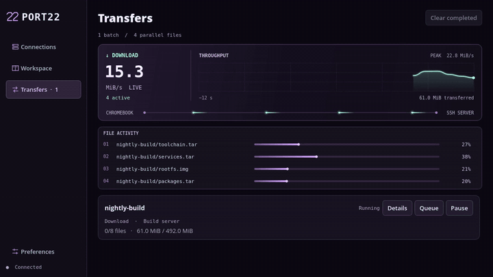
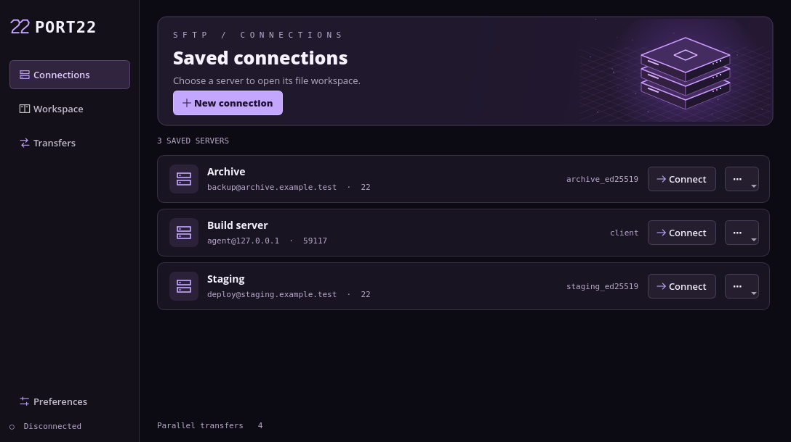
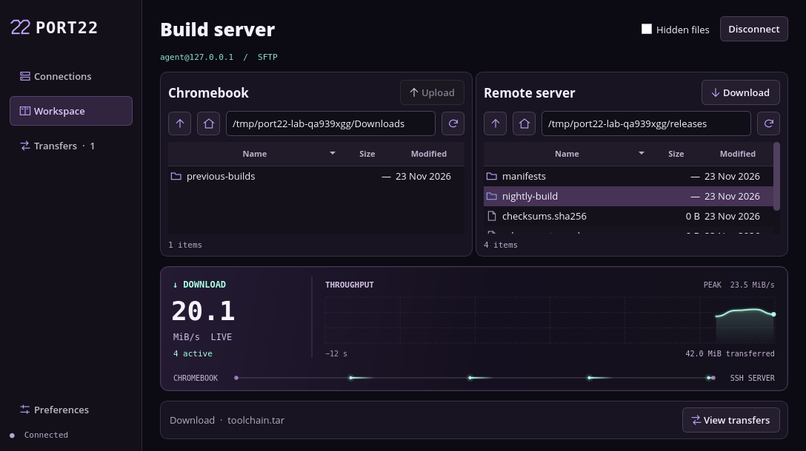

# PORT22

A native SFTP client for Chromebook and Linux. Save your servers and SSH keys, browse local and remote folders side by side, and watch parallel transfers on a live throughput graph.

**[Download PORT22 for Debian / Chromebook](https://github.com/smartdevuk/PORT22/raw/refs/heads/main/packages/port22_1.1.0_all.deb)** · [Installation](#install-on-a-chromebook) · [Full-resolution transfer video](https://github.com/smartdevuk/PORT22/raw/refs/heads/main/docs/media/transfer.mp4)



The nine-second recording shows an actual SFTP download from a local OpenSSH server. The demo connection was bandwidth-limited to keep the transfer visible. The numbers come from the transfer workers.

## Install on a Chromebook

1. Enable the **Linux development environment** if you haven’t used Linux apps before.
2. Download the Debian installer above. In the ChromeOS Files app, move it to the top level of **Linux files**.
3. Open **Terminal** and run the following commands.

   ```sh
   sudo apt update
   sudo apt install ~/port22_1.1.0_all.deb
   ```

4. Search the Launcher for **PORT22**. Right-click the icon and choose **Pin to shelf**. Opening it takes you straight to your saved connections.

The same package targets Debian 12 and 13 on desktop Linux. If you downloaded it to your usual Downloads folder, run `sudo apt install ~/Downloads/port22_1.1.0_all.deb`. The package is architecture-independent and uses Debian's native Qt, Python and SSH libraries.

**Upgrading from Violet Relay 1.0:** close the old app, then install PORT22. APT replaces the earlier package. PORT22 reopens its saved connections, known host keys, preferences and queue. Pin the new PORT22 launcher.

## Connect to a server

Click **New connection**. Give the server a name, enter its hostname or IP address, and use the same username and port you use for SSH. Choose your private key with **Browse…**. OpenSSH, PEM and PuTTY PPK keys are supported for Ed25519, RSA and ECDSA.

PORT22 saves the key's path. Encrypted keys prompt for their passphrase when you connect. On first use, compare the server fingerprint with one obtained through a trusted channel, such as your cloud provider's console. The fingerprint dialog includes the command. PORT22 checks known host keys on reconnect.

Set an optional remote start folder such as `/var/www`. The local pane remembers the last folder for each server. ChromeOS folders shared through **Files → Share with Linux** can be opened under `/mnt/chromeos` or `/mnt/shared`, depending on the Linux environment.

| Saved connections | File workspace |
| --- | --- |
| [](docs/media/connections.png) | [](docs/media/workspace.png) |

## Transfer files

- **Select and copy.** Choose files or folders on either side, then click **Upload** or **Download**. Dragging the selection to the other pane opens the same confirmation. Ctrl-click and Shift-click select multiple entries.
- **Tune parallelism.** Four files transfer at once by default. **Preferences → Simultaneous files** accepts one to eight. The next batch uses the new limit. Pause and resume an active batch to apply it.
- **Read the monitor.** The large number is aggregate payload throughput. The trace shows the last 12 seconds and the peak sampled rate. Route markers follow the direction of travel and advance with transferred bytes. **Transfers** shows each active file and its progress. After a batch stops, the monitor shows its average for that run. Retransmitted bytes count towards throughput. Turn off animation in **Preferences** to keep the readings with reduced motion.
- **Copy directory trees.** Hidden files and empty folders are included. Symbolic links and special files are skipped. Existing directories merge, and extra destination files stay in place. **Skip existing files** is the default. Choose **Replace existing files** when you want to overwrite.
- **Recover a queue.** Transient connection failures are retried. After a restart, reconnect to the same server and use **Transfers → Resume**. Completed files stay completed. An incomplete file restarts from its beginning. **Details** lists failed paths.

PORT22 publishes a replacement after writing a temporary file and checking its length. Remote replacement requires the OpenSSH POSIX rename extension. The queue is stored in SQLite. Only one server is connected at a time.

## Shortcuts

| Shortcut | Action |
| --- | --- |
| Ctrl+1 / Ctrl+2 / Ctrl+3 | Connections / Workspace / Transfers |
| Ctrl+N | New connection |
| Ctrl+H | Show or hide dotfiles in the workspace |
| Enter in a path field | Open that folder |

## Build and test

```sh
sudo apt install python3-pyqt5 python3-paramiko python3-cryptography putty-tools dpkg-dev
./build.sh
sudo apt install ./dist/port22_1.1.0_all.deb
```

For development, run `/usr/bin/python3 port22/app.py` from the checkout. The tests below use throwaway keys, temporary directories and a loopback OpenSSH server. The transfer and GUI tests require `openssh-server`, `openssh-client`, and a local account allowed to authenticate by public key.

```sh
/usr/bin/python3 tests/telemetry_test.py
VIOLET_TEST_FILES=2000 /usr/bin/python3 tests/integration.py
/usr/bin/python3 tests/recovery.py
QT_QPA_PLATFORM=offscreen /usr/bin/python3 tests/gui_smoke.py
```

Fresh installs store settings, the queue and trusted server keys under `~/.local/share/port22/`. Upgrades use the original `violet-relay/` directory. Both honour `XDG_DATA_HOME`. SSH private keys stay in the locations you selected.

[MIT licence](LICENSE)
